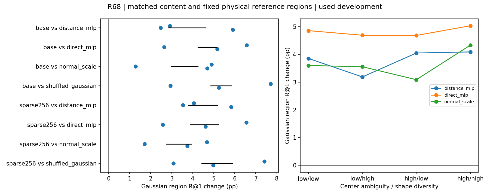

# R68 fixed-region cross-view mechanism study

All methods receive complete20-channel region content. Fifteen paired from-scratch fits; base and sparse inputs use exactly the same reference queries, labels and strata. Sparse observations use known full-density region membership. These are used SUN3D development scenes, not native optimized3DGS.

| Condition | Method | Region R@1 % | Center PCK % | Soft EPE | CE |
|---|---|---:|---:|---:|---:|
| base | distance_mlp | 36.6698 | 12.5278 | 0.4276 | 3.0811 |
| base | direct_mlp | 35.6419 | 12.1154 | 0.4318 | 3.0998 |
| base | normal_scale | 36.8162 | 12.6303 | 0.4293 | 3.0444 |
| base | gaussian_relation | 40.4364 | 13.9754 | 0.3956 | 2.9652 |
| base | shuffled_gaussian | 35.1379 | 11.8571 | 0.4341 | 3.0912 |
| sparse256 | distance_mlp | 32.8734 | 10.8464 | 0.4467 | 3.1771 |
| sparse256 | direct_mlp | 32.7698 | 10.9473 | 0.4505 | 3.2050 |
| sparse256 | normal_scale | 33.9761 | 11.3655 | 0.4433 | 3.1196 |
| sparse256 | gaussian_relation | 37.3505 | 12.6045 | 0.4083 | 3.0360 |
| sparse256 | shuffled_gaussian | 32.1921 | 10.6188 | 0.4522 | 3.1837 |

| Condition | Gaussian minus control | Seed region gains pp | Mean pp | Scene95% pp | Center change pp | Lead |
|---|---|---|---:|---|---:|---|
| base | distance_mlp | +2.921 / +2.471 / +5.909 | +3.767 | [+2.851, +4.621] | +1.448 | True |
| base | direct_mlp | +6.573 / +2.642 / +5.168 | +4.795 | [+4.243, +5.145] | +1.860 | True |
| base | normal_scale | +4.892 / +1.282 / +4.687 | +3.620 | [+2.966, +4.245] | +1.345 | True |
| base | shuffled_gaussian | +7.703 / +2.941 / +5.252 | +5.299 | [+4.853, +5.849] | +2.118 | True |
| sparse256 | distance_mlp | +4.058 / +3.537 / +5.836 | +4.477 | [+3.799, +5.163] | +1.758 | True |
| sparse256 | direct_mlp | +6.554 / +2.576 / +4.612 | +4.581 | [+3.897, +5.233] | +1.657 | True |
| sparse256 | normal_scale | +4.676 / +1.708 / +3.739 | +3.374 | [+2.748, +3.940] | +1.239 | True |
| sparse256 | shuffled_gaussian | +7.415 / +3.081 / +4.980 | +5.158 | [+4.435, +5.885] | +1.986 | True |

Four input-defined strata:0 low ambiguity/low shape diversity;1 low/high;2 high/low;3 high/high.

| Condition | Control | Stratum | Region gain pp | Center gain pp |
|---|---|---|---:|---:|
| base | distance_mlp | 0 | +3.857 | +1.001 |
| base | distance_mlp | 1 | +3.189 | +1.881 |
| base | distance_mlp | 2 | +4.053 | +1.661 |
| base | distance_mlp | 3 | +4.093 | +1.252 |
| base | direct_mlp | 0 | +4.861 | +1.787 |
| base | direct_mlp | 1 | +4.695 | +2.421 |
| base | direct_mlp | 2 | +4.688 | +1.615 |
| base | direct_mlp | 3 | +5.037 | +1.538 |
| base | normal_scale | 0 | +3.602 | +1.006 |
| base | normal_scale | 1 | +3.557 | +1.952 |
| base | normal_scale | 2 | +3.090 | +1.209 |
| base | normal_scale | 3 | +4.335 | +1.211 |
| base | shuffled_gaussian | 0 | +5.440 | +1.884 |
| base | shuffled_gaussian | 1 | +4.720 | +2.444 |
| base | shuffled_gaussian | 2 | +5.409 | +1.883 |
| base | shuffled_gaussian | 3 | +5.513 | +2.154 |
| sparse256 | distance_mlp | 0 | +4.851 | +1.687 |
| sparse256 | distance_mlp | 1 | +3.814 | +1.862 |
| sparse256 | distance_mlp | 2 | +4.262 | +1.848 |
| sparse256 | distance_mlp | 3 | +4.987 | +1.648 |
| sparse256 | direct_mlp | 0 | +4.801 | +1.649 |
| sparse256 | direct_mlp | 1 | +4.979 | +2.260 |
| sparse256 | direct_mlp | 2 | +3.936 | +1.202 |
| sparse256 | direct_mlp | 3 | +4.701 | +1.527 |
| sparse256 | normal_scale | 0 | +3.625 | +1.343 |
| sparse256 | normal_scale | 1 | +3.660 | +1.363 |
| sparse256 | normal_scale | 2 | +2.511 | +1.264 |
| sparse256 | normal_scale | 3 | +3.742 | +0.974 |
| sparse256 | shuffled_gaussian | 0 | +5.519 | +2.021 |
| sparse256 | shuffled_gaussian | 1 | +5.185 | +2.113 |
| sparse256 | shuffled_gaussian | 2 | +4.863 | +1.892 |
| sparse256 | shuffled_gaussian | 3 | +4.982 | +1.874 |

Coverage and counts are in data/*json and each result group. Both conditions preserve their exact reference population; valid_and_correct_fraction is valid-and-correct divided by all queries, not unmatched-query rejection accuracy. Scene intervals condition on three selected seeds and only five scenes; they do not establish broad generalization. Input strata are association diagnostics, not causal proof. Scientific and actual visual review completed; see review.json.

## Reviewed interpretation (2026-11-04)

同信息对照下，完整高斯关系在基础/固定查询稀疏条件分别达到40.436%/37.351%。
相对距离为+3.767/+4.477pp，相对完整原始几何MLP为+4.795/+4.581pp，
相对法向/尺度为+3.620/+3.374pp；这些区域差在三个种子、五个场景均为正。
三个种子的中心PCK、Soft EPE及CE也都改善，因此不能用牺牲中心定位解释区域收益。
打乱PE形状关联而保留正确内容后下降，与强对照比较一起支持正确关系组织有用；
单独打乱对照不作成功证据。

所有输入分组都改善，事前预测的高歧义/高形状差异组没有独占或一致更大的
收益。因此“关系组织有用”的实验证据强于“恰因该类歧义被消除”的机制解释。
共同内容仍有坐标依赖；完整关系与法向对照也同时改变代数组织，不能唯一归因
于三轴性或宣称整个网络精确刚体不变。

固定查询后，五种方法的召回都随稀疏化下降。高斯保持领先，但基础到稀疏的
降幅约3.086pp，并不小于Direct的2.872pp或法向控制的2.840pp；其距离对照
降幅3.796pp。不能把“稀疏下分数更好”扩大成“对每种对照都更耐稀疏”。
有效查询始终为20422/61440。已知原区域划分的条件和33.239%覆盖率须与分数一起保留。

全部15次训练各60epochs/1080updates，21个队列子任务退出0。共同初始化与
每个种子的60轮实际输入流完全配对，所有模型先选定再导出30组评估。
独立Torch/NumPy全量微平均指标最大差4.44e-16；另以逐对逐方向计数重算
全部场景/分组的主指标和中心指标，误差与计数差均为0。图已实际查看：蓝点
表示种子差，黑线为条件于这三个种子的五场景bootstrap区间；不是种子总体区间。
该复核由同一代理使用独立算术路径完成，不是外部研究者复现。

PE参数：Distance9408、Direct10848、Normal10272、Gaussian/Shuffle10368；
整体参数分别324721、326161、325585、325681。GPU训练峰值约0.64–0.65GiB，
共享服务器训练计时不作正式速度排名。

保留这版作为有可信开发效用的候选。下一项最多三类输入精简、各三种子，
检验相对位移-形状耦合能否保留收益；不扫描温度/频率/宽度。随后检验图像任务
用途。此结果不推翻已有分类、直接迁移与RGB负结果，也没有完成一般性或新数据确认。
