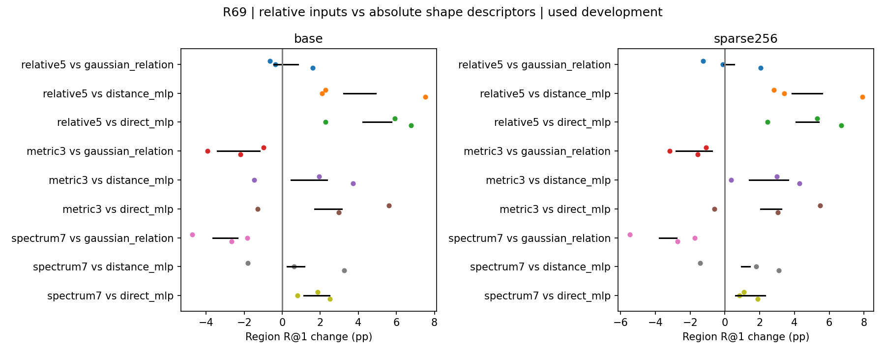

# R69 fixed relation-column decomposition

Nine new paired fits, thirty identity-verified reused R68 evaluation groups. Used development only.
Descriptive compact candidate: relative5. This is not a formal noninferiority conclusion.

| Condition | Method | Region R@1 % | Center PCK % | Soft EPE | CE |
|---|---|---:|---:|---:|---:|
| base | distance_mlp | 36.6698 | 12.5278 | 0.4276 | 3.0811 |
| base | direct_mlp | 35.6419 | 12.1154 | 0.4318 | 3.0998 |
| base | normal_scale | 36.8162 | 12.6303 | 0.4293 | 3.0444 |
| base | gaussian_relation | 40.4364 | 13.9754 | 0.3956 | 2.9652 |
| base | shuffled_gaussian | 35.1379 | 11.8571 | 0.4341 | 3.0912 |
| base | relative5 | 40.6283 | 14.2208 | 0.4016 | 2.9748 |
| base | metric3 | 38.0663 | 13.1434 | 0.4144 | 3.0491 |
| base | spectrum7 | 37.3627 | 12.7094 | 0.4206 | 3.0535 |
| sparse256 | distance_mlp | 32.8734 | 10.8464 | 0.4467 | 3.1771 |
| sparse256 | direct_mlp | 32.7698 | 10.9473 | 0.4505 | 3.2050 |
| sparse256 | normal_scale | 33.9761 | 11.3655 | 0.4433 | 3.1196 |
| sparse256 | gaussian_relation | 37.3505 | 12.6045 | 0.4083 | 3.0360 |
| sparse256 | shuffled_gaussian | 32.1921 | 10.6188 | 0.4522 | 3.1837 |
| sparse256 | relative5 | 37.5762 | 12.8276 | 0.4134 | 3.0352 |
| sparse256 | metric3 | 35.4110 | 11.9610 | 0.4257 | 3.1145 |
| sparse256 | spectrum7 | 34.0371 | 11.1905 | 0.4410 | 3.1613 |

| Condition | Candidate minus control | Paired region gains pp | Mean pp | Scene95% pp | Center pp |
|---|---|---|---:|---|---:|
| base | relative5 - gaussian_relation | -0.657 / -0.368 / +1.601 | +0.192 | [-0.436, +0.820] | +0.245 |
| base | relative5 - distance_mlp | +2.264 / +2.102 / +7.509 | +3.958 | [+3.219, +4.907] | +1.693 |
| base | relative5 - direct_mlp | +5.917 / +2.274 / +6.769 | +4.986 | [+4.225, +5.748] | +2.105 |
| sparse256 | relative5 - gaussian_relation | -1.256 / -0.130 / +2.064 | +0.226 | [-0.074, +0.522] | +0.223 |
| sparse256 | relative5 - distance_mlp | +2.802 / +3.407 / +7.900 | +4.703 | [+3.869, +5.572] | +1.981 |
| sparse256 | relative5 - direct_mlp | +5.298 / +2.445 / +6.676 | +4.806 | [+4.086, +5.386] | +1.880 |
| base | metric3 - gaussian_relation | -0.979 / -3.933 / -2.198 | -2.370 | [-3.408, -1.179] | -0.832 |
| base | metric3 - distance_mlp | +1.941 / -1.463 / +3.711 | +1.396 | [+0.469, +2.347] | +0.616 |
| base | metric3 - direct_mlp | +5.594 / -1.291 / +2.970 | +2.424 | [+1.714, +3.135] | +1.028 |
| sparse256 | metric3 - gaussian_relation | -1.080 / -3.179 / -1.559 | -1.939 | [-2.815, -0.756] | -0.644 |
| sparse256 | metric3 - distance_mlp | +2.978 / +0.358 / +4.277 | +2.538 | [+1.399, +3.641] | +1.115 |
| sparse256 | metric3 - direct_mlp | +5.475 / -0.603 / +3.052 | +2.641 | [+2.063, +3.238] | +1.014 |
| base | spectrum7 - gaussian_relation | -4.719 / -1.846 / -2.656 | -3.074 | [-3.657, -2.359] | -1.266 |
| base | spectrum7 - distance_mlp | -1.798 / +0.625 / +3.253 | +0.693 | [+0.263, +1.172] | +0.182 |
| base | spectrum7 - direct_mlp | +1.854 / +0.796 / +2.512 | +1.721 | [+1.135, +2.492] | +0.594 |
| sparse256 | spectrum7 - gaussian_relation | -5.478 / -1.738 / -2.724 | -3.313 | [-3.785, -2.785] | -1.414 |
| sparse256 | spectrum7 - distance_mlp | -1.420 / +1.799 / +3.111 | +1.164 | [+0.957, +1.428] | +0.344 |
| sparse256 | spectrum7 - direct_mlp | +1.077 / +0.838 / +1.887 | +1.267 | [+0.602, +2.297] | +0.243 |

No search or additional fitting is authorized by a failed simplification. Retain full11 if required. Known original region membership under thinning; unchanged20422 valid out of61440 queries. Scene intervals condition on the selected three seeds. Scientific and actual visual review completed; see review.json.

## Reviewed interpretation (2026-11-04)

选relative5作为下一阶段候选。它将中心距离、两个方向的形状标准化位移、
两个方向的相对形状trace量送入一个5→96→96 MLP，作为注意力q·r位置项。
没有新增模块。PE9792参数，比距离MLP多384，比原full11少576；这是关系
输入的精简，不是网络规模或二次复杂度的大幅压缩，也不是新的RoPE公式。

基础区域R@1为40.628%，稀疏37.576%；相对Distance为+3.958/+4.703pp，
相对Direct为+4.986/+4.806pp，三个种子、五个场景的区域差都为正；三个
种子的中心PCK、Soft EPE和CE也都更好。法向/尺度对照亦未补齐这部分差距。

相对full11，区域均值仅+0.192/+0.226pp，两个种子仍变差，稀疏seed11
为−1.256pp；区间跨零。Soft EPE均值反而较full11差约.0060/.0051，基础
CE也差.0096。选择5维是按事前容差保留召回/中心效用并减少输入量，不能
写成全面优于或严格等效于11维。全部种子及次要指标保留。

metric3相对full11在基础/稀疏分别低2.370/1.939pp，所有种子均低；仅尺度
谱spectrum7则低3.074/3.313pp。保留双侧相容关系比进一步压成三个量更有
依据。绝对谱六通道并非这组收益所必需，但谱仍存在于共同内容中；不能
扩大成绝对尺度信息整体无用。不同MLP输入维度/初始化也随消融变化，结果
支持本次配对训练的关系组合，不是功能族不可能性或单一物理因果定理。

九次新拟合均60epochs/1080steps，与R68共同参数初值和每个种子的60轮
实际输入流完全配对。九个模型先选定再生成18组新预测，30组旧预测按身份
复用而未冒充新确认。15个子任务退出0；全量独立微平均指标最大差8.88e-16，
另以逐对逐方向独立计数检查全部场景/分组的区域与中心指标，误差与计数差
均为0。图已实际查看，点为种子差、黑线为五场景条件区间。本代理的独立
算术复核不是外部研究者复现。

停止这次精简，采用relative5进入Transformer图像任务的用途检验。新候选
尚未验证原生3DGS、RGB/新视角合成或新数据确认；R65/R66以及R67的分类
限制和此前RGB失败不能被本轮匹配收益覆盖。全局目标仍未完成。
