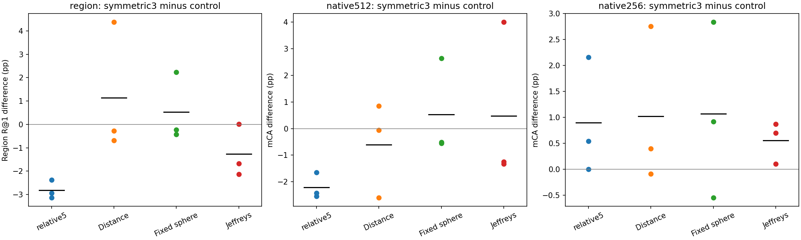
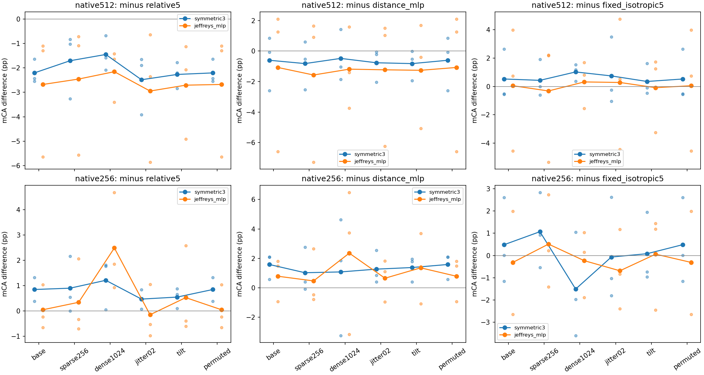

# 对称关系检验：压缩损失核心用途，保留五维候选

2026-11-06，15 次拟合、统一选模、216 组新旧预测和实际审阅完成。三维对称化没有保留原五维的区域与原生 512 基元收益，因此不将它升级为通用候选。原生可学习 Jeffreys 控制也未形成更强的一般替代。匹配 256 基元下的局部改善保留，但不覆盖另外两个主条件的退步。

## 固定问题与比较

假设是两端角色可以合并，仍保留有用的区域方向/范围关系；竞争解释是两端的独立信息有实际用途，原有数量依赖也不由对称化解决。按照[事前计划](../../../docs/symmetric_relation_plan.md)，只将五维 `[d,ai,aj,bi,bj]` 变为 `[d,u,u,v,v]`，其中 `u=(ai+aj)/2`、`v=(bi+bj)/2`，平均发生在 log 之后。只有三个独立输入，仍沿用同一个五输入 MLP、完整初始状态和 9,792 个 PE 参数。Jeffreys 使用距离加双向高斯 KL 的 log 值重复槽，是两个独立量。

区域新增三拟合，原生 512 与匹配 256 各新增 symmetric3/Jeffreys 的三种子拟合，种子均为 11/22/33。区域沿用 60 epochs/1,080 updates，原生沿用 120 epochs/46,800 updates。数据、完整共同内容、原优化器、协方差 floor、距离单位与各流程的选模规则保持不变。所有 15 个模型统一选定后才导出旧开发集；本轮没有读取官方 TEST 或九场景确认集。

## 主结果

区域报告场景宏平均 R@1；原生报告 60 类宏平均准确率 mCA。单位为百分比。

| 方法 | 区域基础 R@1 | 原生 512→512 mCA | 原生 256→256 mCA |
| --- | ---: | ---: | ---: |
| 五维 relative5 | **40.628** | **80.029** | 76.743 |
| Distance MLP | 36.670 | 78.426 | 76.620 |
| 固定球形五输入 | 37.288 | 77.298 | 76.573 |
| 对称三维 symmetric3 | 37.811 | 77.824 | **77.642** |
| 可学习 Jeffreys | 39.074 | 77.351 | 77.085 |

| 对称三维减对照 | 区域基础：均值 / 三种子 pp | 原生 512：均值 / 三种子 pp | 匹配 256：均值 / 三种子 pp |
| --- | --- | --- | --- |
| 五维 | −2.817 / −2.946, −2.372, −3.134 | −2.206 / −2.542, −1.644, −2.431 | +0.900 / +0.000, +0.540, +2.158 |
| Distance | +1.141 / −0.682, −0.269, +4.375 | −0.603 / +0.852, −2.595, −0.064 | +1.023 / −0.086, +0.399, +2.755 |
| 固定球形 | +0.523 / −0.232, −0.433, +2.235 | +0.526 / −0.510, −0.557, +2.644 | +1.069 / +0.919, −0.546, +2.835 |

区域对五维的种子×场景重采样区间为 **[−3.728,−2.119] pp**；原生 512 对五维为 [−4.699,+0.116] pp，但三种子均退步，均值损失超过 2 pp。决定停止该替代方案依据的是核心用途的实际损失，不是微小数值差或要求所有区间严格同号。匹配 256 对五维 / Distance / 固定球形的种子×类别区间分别为 [−1.671,3.710] / [−1.771,4.152] / [−1.875,4.210] pp，仍较宽；第一项种子 11 的极小正差四舍五入后为 +0.000。

## 中心定位、条件与来源

区域对称化的退步并非区域召回换取中心定位。对五维，基础 / 固定查询稀疏召回分别低 **2.817 / 3.251 pp**，中心 PCK 低 **1.010 / 1.277 pp**；hard EPE 增加 0.02457 / 0.03754，soft EPE 增加 0.02138 / 0.02804，CE 增加 0.07402 / 0.09774。上述指标在三个种子均退步，基础的 15 个种子×场景召回差也全部为负。对 Distance 的区域均值仍较好，但方向不稳定；对固定球形的稀疏召回仅多 0.112 pp，hard/soft EPE 均值反而更差。对 GeoTransformer，基础 / 稀疏平均多 1.286 / 1.270 pp，也不能恢复原五维约 4 pp 的优势。

原生各条件的 mCA 差如下；permuted 与 base 的类别预测完全相同，不计作独立重复。

| 训练流程 / 左减右 | base512 | sparse256 | dense1024 | jitter02 | tilt |
| --- | ---: | ---: | ---: | ---: | ---: |
| 512：三维−五维 | −2.206 | −1.708 | −1.453 | −2.485 | −2.268 |
| 512：三维−Distance | −0.603 | −0.820 | −0.481 | −0.767 | −0.822 |
| 512：Jeffreys−五维 | −2.678 | −2.457 | −2.156 | −2.947 | −2.707 |
| 512：Jeffreys−Distance | −1.075 | −1.569 | −1.185 | −1.229 | −1.260 |
| 256：三维−五维 | +0.848 | +0.900 | +1.210 | +0.469 | +0.548 |
| 256：三维−Distance | +1.583 | +1.023 | +1.077 | +1.267 | +1.376 |
| 256：三维−固定球形 | +0.486 | +1.069 | **−1.509** | −0.069 | +0.080 |

512 流程中，三维和 Jeffreys 对五维的每个条件、每个种子 mCA 均更低，基础 OA 也均退步。Jeffreys 的基础平均为 77.351%，对五维 −2.678 pp、对 Distance −1.075 pp；种子 22 对 Distance 为 −6.593 pp，其余两种子为 +2.103/+1.265 pp。该种子完整完成预算、损失与梯度有限、初始化和采样流匹配，GPU 选模回放一致；没有根据低分将它删除或重跑。

匹配 256 中，三维对 Distance / 固定球形的 CE 三种子均改善，平均 −0.02644/−0.03401；对五维的 CE 平均略差 +0.00159，OA 差为 −0.523/+0.523/+0.915 pp。因此 +0.900 pp 的 mCA 均值不代表全部预测指标改善。其形状收益也依赖来源：三维对固定球形在 ModelNet 子组的三种子均为负；256→1024 对固定球形仍低 1.509 pp。Jeffreys 的匹配 256 mCA 对五维只多 +0.342 pp，种子方向混合、CE 平均更差。完整来源、60 类、区域四分组和配对次指标保存在 [result.json](result.json) 与 [审阅分析](actual_review1/analysis.json)，不以细小负项额外设置通用门槛。

## 执行与核查范围

32 个队列任务全部退出码 0，其中 15 项拟合完整结束，没有原生训练恢复或额外种子。所有训练轮的损失及末步梯度范数有限；初始化、区域 60 轮与原生 120 轮实际采样流和既有五维配对一致。整段训练分配峰值区域约 0.641 GiB，原生 512 约 12.167 GiB，原生 256 约 4.032–4.033 GiB。实际占用影响运行耗时，本轮不以跨卡训练时间宣称结构效率。

48 个来源文件、308 项既有证据身份和五项缓存身份核对通过，全局 15 模型选模记录有效。78 组新预测与 138 组复用预测合计 216 组；指标独立计算最大误差 8.88e−16。新模型 GPU 选模回放误差为零；原生 CPU 回放最大 logit 差 8.94e−6，没有类别改变。30 个原生模型排列回放最大 logit 差 7.63e−6，没有类别改变。这些尾数差不影响科学判断。

区域 hard EPE 按相同有效查询掩码从所有旧/新保存预测补算，沿用五场景等权汇总，覆盖 20,422/61,440 个有效查询。主比较图与全部原生条件图已经实际查看，与逐种子和汇总表一致。原始自动报告保留在 [automatic_report.md](actual_review1/automatic_report.md)；result.json 和队列内的 pending 字段是生成时快照，最终审阅状态以 [review.json](review.json) 为准。

## 判断与下一步

本次支持“在当前模型与预算下，分别保留两端关系比这一对称平均更有用”，没有证明所有三维编码都不可能，或方向性是所有任务的唯一原因。重复槽实现保留初始化与参数量，其优化过程也不等于实际三输入网络；没有测得压缩后的速度收益。

按事前决定，不推广 symmetric3 或 Jeffreys，不追加温度、门控和归一化来追逐本批开发分数。保留只有一个关系 MLP 的五维作为当前候选，下一步准备固定模型的跨来源确认：检验在 MACGS 来源学习的七个类别，能否直接识别无已知历史 ID 重叠的 ModelNet 原 test 对象。对象、完整 60 类输出、强对照、种子和分析将在读取新高斯与分数前固定；不重训、不按新结果选模型。这可以检验用途边界，而不只是继续在旧数据上压缩输入维度。

所有既有确认与 RGB/直接迁移负结果保留。当前尚无一般有效方案；本次旧数据开发比较也不是新的独立确认。
