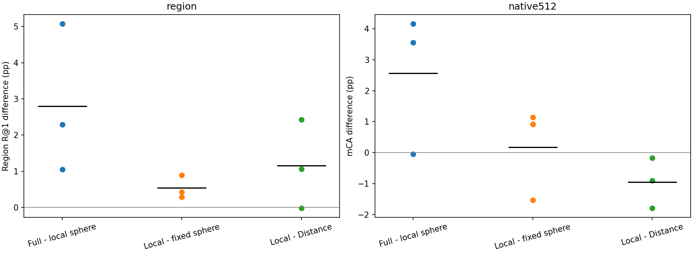
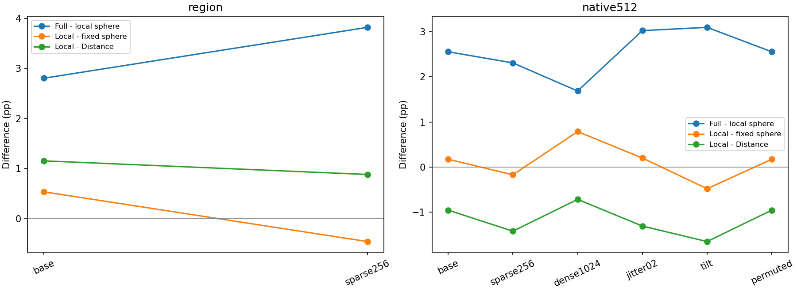

# 局部大小与完整椭球关系：完成结果与实际审阅

2026-11-07。六次训练、统一选模、24 组新预测、72 组旧预测、完整条件与错误分析均已完成，18 个执行任务全部正常退出。CPU/CUDA 预检、训练配对、独立指标计算、逐样本事件和两幅图已实际审阅。它是旧开发数据上的机制检验，不是新的独立数据确认。

## 判断

**保留完整五维 relative5，不采用各自大小球形作为替代。** 在本轮保持平均平方尺度的控制下，局部大小没有解释大部分优势：区域中完整五维比局部球形高 **2.804 pp**，三个种子均改善，五个场景的均值差均正；固定查询稀疏条件差为 **3.820 pp**。局部球形对固定球形仅基础 +0.536 pp，稀疏反而 −0.457 pp。

原生 512 分类也倾向完整五维：80.029% 对 77.471%，平均 **+2.558 pp**；局部球形比 Distance 低 **0.955 pp**、三个种子均低。完整五维对局部球形的配对差是 +3.560 / −0.048 / +4.163 pp。中间那个接近零的差异本身不是否决理由；实质限制是只有三个种子、类别和来源差异明显，联合种子×类别区间 [−0.666, 6.456] pp 仍宽。OA 和 CE 则三个种子均支持完整五维。

因此，区域结果支持“在这种尺度匹配下，方向与非球形结构的联合关系提供了额外用途”；原生结果提供同方向的平均证据，但稳定程度较弱。**不能单独归因到朝向，不能证明任意尺度编码都无效，也不能据此宣称一般有效。** 原生强 Distance 对照的既有确认不确定性、RGB 和迁移反例均保留。

## 比较为何能回答这个问题

仅在 PE 中把每个 Σi 替换成 ri·I，其中 ri=tr(Σi)/3；保持中心、标签、完整共同内容、5→96→96 MLP、9,792 个 PE 参数、完整初始化、实际采样流、优化器和更新预算。区域三个种子各 60 轮/1,080 步，原生各 120 轮/46,800 步。选模沿用各原流程的验证 CE，六模型全部固定后才导出开发预测。

完整协方差仍在共同内容中。本轮检验的是把关系显式放进 PE 的用途，不是把所有形状信息从 Transformer 中删除。trace 球形保留平均平方尺度，不保留体积、精度或长短轴方向；这些不同的匹配定义不能混为一个物理控制。

## 主读数、配对差与错误事件

| 任务 | 方法 | 三种子指标 % | 均值 % |
| --- | --- | --- | ---: |
| region | relative5 | 41.403 / 38.685 / 41.797 | 40.628 |
| region | distance_mlp | 39.139 / 36.583 / 34.287 | 36.670 |
| region | fixed_isotropic5 | 38.689 / 36.747 / 36.428 | 37.288 |
| region | trace_isotropic5 | 39.116 / 37.640 / 36.716 | 37.824 |
| native512 | relative5 | 81.225 / 78.590 / 80.273 | 80.029 |
| native512 | distance_mlp | 77.831 / 79.542 / 77.907 | 78.426 |
| native512 | fixed_isotropic5 | 79.192 / 77.503 / 75.199 | 77.298 |
| native512 | trace_isotropic5 | 77.664 / 78.639 / 76.111 | 77.471 |

| 任务 | 左减右 | 三种子差 pp | 均值 pp | 种子×场景/类别区间 pp |
| --- | --- | --- | ---: | --- |
| region | relative5 − trace_isotropic5 | +2.287 / +1.046 / +5.080 | +2.804 | [+1.011, +5.223] |
| region | trace_isotropic5 − fixed_isotropic5 | +0.427 / +0.893 / +0.289 | +0.536 | [-0.400, +1.313] |
| region | trace_isotropic5 − distance_mlp | -0.023 / +1.056 / +2.429 | +1.154 | [-0.012, +3.001] |
| region | relative5 − distance_mlp | +2.264 / +2.102 / +7.509 | +3.958 | [+1.735, +7.241] |
| region | relative5 − fixed_isotropic5 | +2.714 / +1.939 / +5.369 | +3.340 | [+1.870, +5.442] |
| native512 | relative5 − trace_isotropic5 | +3.560 / -0.048 / +4.163 | +2.558 | [-0.666, +6.456] |
| native512 | trace_isotropic5 − fixed_isotropic5 | -1.528 / +1.136 / +0.912 | +0.173 | [-2.588, +3.041] |
| native512 | trace_isotropic5 − distance_mlp | -0.166 / -0.903 / -1.796 | -0.955 | [-3.540, +1.753] |
| native512 | relative5 − distance_mlp | +3.394 / -0.951 / +2.367 | +1.603 | [-1.604, +5.054] |
| native512 | relative5 − fixed_isotropic5 | +2.033 / +1.087 / +5.074 | +2.731 | [-0.236, +6.097] |

| 任务 | 左减右 | 纠正率 % | 新增错误率 % | 全种子纠正/退步个数 |
| --- | --- | ---: | ---: | --- |
| region | relative5 − trace_isotropic5 | 15.040 | 12.236 | 258 / 187 |
| region | trace_isotropic5 − fixed_isotropic5 | 9.957 | 9.421 | 64 / 62 |
| region | trace_isotropic5 − distance_mlp | 11.955 | 10.800 | 100 / 63 |
| native512 | relative5 − trace_isotropic5 | 7.809 | 5.251 | 6 / 0 |
| native512 | trace_isotropic5 − fixed_isotropic5 | 6.377 | 6.204 | 1 / 2 |
| native512 | trace_isotropic5 − distance_mlp | 5.574 | 6.529 | 4 / 3 |

## 定位、扰动与来源

区域完整五维减局部球形：基础 PCK +1.178 pp、hard EPE −0.02290、soft EPE −0.02388、CE −0.07021；稀疏 PCK +1.399 pp、hard EPE −0.04034、soft EPE −0.03177、CE −0.10538。PCK、hard EPE、CE 在两条件均为三个种子改善；基础 seed 11 的 soft EPE 有 +0.000368 的小退步，完整保留，不据此否决区域主结果。

| 任务/条件 | 完整−局部球形 pp | 局部−固定球形 pp | 局部−Distance pp |
| --- | ---: | ---: | ---: |
| region/base | +2.804 | +0.536 | +1.154 |
| region/sparse256 | +3.820 | -0.457 | +0.883 |
| native512/base | +2.558 | +0.173 | -0.955 |
| native512/sparse256 | +2.311 | -0.172 | -1.423 |
| native512/dense1024 | +1.688 | +0.788 | -0.717 |
| native512/jitter02 | +3.028 | +0.201 | -1.309 |
| native512/tilt | +3.100 | -0.480 | -1.653 |
| native512/permuted | +2.558 | +0.173 | -0.955 |

原生完整五维对局部球形的 OA 差为 +2.484 / +0.261 / +2.222 pp，CE 差为 −0.0760 / −0.0712 / −0.0362。MACGS 的 mCA 差 +4.057 / +2.032 / +5.062 pp；ModelNet 为 +3.063 / −2.129 / +3.263 pp。六条件平均 mCA 都倾向完整五维，base/dense/permuted 有配对反例；dense 的 seed 33 CE 也略差。不能筛除弱种子或来源后声称普遍稳定。permuted 只是实现检查，不算新的独立实验。

区域完整−局部球形的基础四分组差为 +3.053 / +2.354 / +2.743 / +3.320 pp，各组均为三种子正。低/高中心歧义组分别 +2.630 / +2.986 pp；高歧义更大并非逐种子一致，不能解释为收益只来自高歧义。稀疏四组也全部为正。所有组的分数、样本数及各场景差保留在 result.json 与 error_analysis.json。

新的区间按原计划同时重采样种子与场景/类别，描述三种子及已用开发群体的不确定性；不是正式等效检验。旧“完整−固定球形”的原生均值仍是 +2.731 pp，本轮联合区间跨零，而旧报告固定种子、只重采样类别的区间为正。两种区间回答不同的不确定性问题，原分数和历史判断没有改写，复用预测不构成新独立证据。

## 纠正与引入错误

区域完整五维相对局部球形，场景等权纠正率为 15.040%，新增错误率为 12.236%；258 个有效查询在三种子中都被纠正，187 个都退步，1,916 个随种子出现相反方向。原生对应 7.809%/5.251%，6 个对象三种子均被纠正、0 个均退步，但仍有 92 个对象至少在一个种子退步、31 个发生方向反转。不能把“无全种子一致退步对象”写成没有代价。

固定 ID 顺序的区域例子 `harvard_c11/hv_c11_2:109:124|1|32` 中，完整模型三次都选 12，球形模型选 6/34/34；反例 `harvard_c11/hv_c11_2:125:140|1|28` 中，完整模型选 46/46/27，球形模型三次都选正确的 11。原生 `12/060151a0.ply` 的标签 12 被完整模型三次识别正确，球形模型三次预测为 0；全部六个一致纠正对象与其余事件已保存。这些是预测核对，不把尚未展示的几何图形或语义机制附会到编号上。

事件总数使用种子×查询/对象，宏平均率使用场景/类别等权；二者分母不同。完整 40 组事件的计数、宏平均差和固定案例 ID/预测已独立复算，差仅浮点尾数。全部事件均保留，没有仅导出成功案例。

## 实现与审阅

- 六次拟合完整，所有训练损失有限，初始共同参数及全部 epoch 采样流与旧 relative5 一致；完整初始化与 RNG 同一性的 CPU 检查也已通过。
- 区域选中 33/27/21 轮，原生选中 80/90/110 轮，均遵循原验证 CE 规则。区域的 selection_ce 是原两方向等权选模量，不等同汇报用的 ce；审阅脚本最初混用字段的错误已记录并修正，模型、原结果和选模均未改动。
- 原生 GPU 验证回放完全一致，CPU 最大 logit 差 5.007e−6、预测无变化；区域验证回放也满足原容差且预测不变。独立主指标最大误差 8.882e−16。
- 全部原生模型排列前后预测无变化，最大 logit 差 8.822e−6。它是普通浮点尾差，不设新科学门禁。
- 两幅图均实际查看，种子散点、均值、差值方向和条件标签与表格一致。审阅由同一研究代理通过独立算术路径完成，不是外部实验室复现。

## 本轮决定与下一项科学问题

本轮不升级球形版本、不增加模块、不重新使用旧确认集来选择方案。保留 relative5；其强对照的一般稳定收益仍未证明，总体研究目标保持进行中。

目前已经削弱“优势主要是每个区域大小不同”的解释。下一项有价值的问题是：额外收益来自位移相对于椭球的方向性度量，还是两个椭球之间的相容关系，或两者共同作用？旧 metric3 删除形状—形状项时也改变了输入维度和初始化，不足以单独回答。后续控制应维持现有五个槽位与初始化，分别替换关系分量，事前说明不同结果如何决定保留或简化；不从本轮均值直接引入门控/新温度，也不自动升级为新的跨来源确认。

## 证据入口

[冻结计划](../../../docs/trace_isotropic_plan.md) · [公式与初始化检查](../preparation/cpu_checks.json) · [冻结身份](lock.json) · [六模型选定](selected.json) · [全部分数](result.json) · [错误与固定案例](error_analysis.json) · [逐项复算与判断](actual_review1/analysis.json) · [自动报告原件](actual_review1/automatic_report.md) · [审阅脚本修正](actual_review1/diagnostic_fix1.json) · [实际审阅](review.json)

