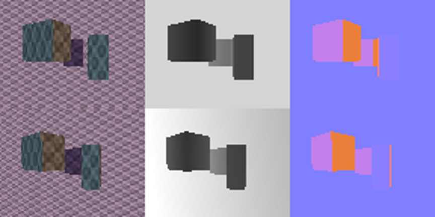

# 第二轮：身份对照、渲染匹配与可靠性验证

日期：2026-10-29。第一轮报告保留在 [research_report.md](research_report.md)。本轮协议见 [ROUND2_PROTOCOL.md](ROUND2_PROTOCOL.md)。

## 研究判断

第一轮接近 99% 的结果不能作为高斯几何创新的证据：跨视角共享的随机身份描述子达到同等成绩。改用有实际相机、纹理表面、独立图像 patch 网格和遮挡的渲染任务后，法向仍有一定价值，但额外各向异性/完整协方差未显示稳定独立收益。门控和区域重叠的结果必须与同容量、同位置信息的对照一起判断，不能只看相对于弱基线的提升。

本轮完成 30 次身份对照训练、100 次渲染匹配训练和 5 次共享 RGB 几何预测器训练。渲染匹配每次 600 步，五种子；真值与混合几何训练分开统计。空闲物理 GPU 3 用于匹配，空闲 GPU 2 用于小型 RGB 几何预测器，没有抢占其他进程。渲染匹配耗时 855.4 秒，峰值 PyTorch allocated 显存 316.9 MiB（不含 CUDA 上下文）。

## 1. 身份信息对照：此前的解释需要收缩

单位为 Recall@1（%），同一训练设置；区域/全部共享几何列是独立控制条件，不是重新训练后的最优值。

| 对照 | 独立随机形状 | 区域共享几何 | 全部共享几何 |
|---|---:|---:|---:|
| 位置 RoPE | 92.87 | 92.87 | 92.87 |
| + 法向 | 97.06 | 93.28 | 92.84 |
| + log 协方差 | 98.92 | 92.76 | 92.14 |
| + 共享随机身份 | 98.95 | 98.95 | 98.95 |
| + 独立随机描述子 | 91.04 | 91.04 | 91.04 |

共享身份为无几何意义的 6 维高斯向量，两视角有独立观测噪声；只在单独的校准训练分布上匹配 log 协方差的逐维边缘方差和对应残差方差。高阶分布没有强行匹配。独立随机对照没有对应身份，不能单独排除该混杂因素。

因此，“额外稳定描述子帮助检索”仍成立；“第一轮高分说明高斯物理形状更适合 PE”尚不成立。同一局部区域四个 token 共享几何后，形状优势大幅缩小，进一步支持身份解释。它不证明几何在所有任务中无用。

## 2. 新任务的几何与标签

两台相机独立渲染背景平面和三个带重复纹理的立方体，每视角 96×72 像素、48 个 12×12 patch。最近正向射线交点决定 RGB、深度、法向和遮挡。一个面的多个 patch 共享法向，协方差由相机与局部平面诱导的 patch footprint 决定，不再随机赋予独特形状。

对应标签是**查询中心点到目标 patch**：点可见、在画幅内，且目标 patch 中心在同一表面时记为对应；否则进入第 49 个无对应类别。它允许多个查询映射到同一目标 patch，也不是像素级一一匹配。边界混合 patch 被保守地视为不可表示，对结果有影响。

每种子 192 个基础训练、48 个验证、96 个测试场景；测试每条件合计 480 场景、23,040 个查询。`oracle_train` 用真值训练；`robust_train` 用 oracle/mixed/depth_fit 等量训练和验证。两协议分别保持相同内容网络、初始化、批次、优化配置与步数，不跨协议挑最好的成绩混成一张排名。

匹配器是实际 RGB patch 的小型 MLP 编码器与单头 Q/K 打分，不是多层 Transformer。所有变体登记相同参数，未使用的分支不参与基线计算。几何权重只有少量标量；门控额外有效容量通过随机惩罚和位置门控对照检查。

## 3. 真值几何与独立误差消融

下表为 oracle_train，visible Recall@1（%，真值列为五种子均值±标准差）。无对应预测对可匹配查询计为错误。

| 方法 | 真值几何 | 深度误差 | 法向误差 | 尺度误差 | 混合误差 | 有噪深度估计 |
|---|---:|---:|---:|---:|---:|---:|
| 位置 3D RoPE | 95.28 ± 1.61 | 84.97 | 95.28 | 95.28 | 92.42 | 93.04 |
| + 法向 | 96.30 ± 1.30 | 87.78 | 56.65 | 96.30 | 82.67 | 88.97 |
| + 法向与各向异性比 | 95.98 ± 1.39 | 88.40 | 46.64 | 48.50 | 58.41 | 87.50 |
| + 完整协方差 | 95.88 ± 1.20 | 88.86 | 5.38 | 50.70 | 47.61 | 79.92 |
| + 法向与独立不确定性 | 96.01 ± 1.85 | 86.42 | 57.18 | 96.01 | 82.00 | 89.76 |

法向相对位置 RoPE 的逐场景平均增益为 1.07 个百分点，分层配对 bootstrap 95% 区间 [0.16, 1.96]。该值按场景平均，与上表每种子内部按查询计数的汇总可略有不同。

各向异性比相对法向的逐场景增益为 -0.35 个百分点，区间 [-0.55, -0.16]。当前没有稳定证据表明应把额外各向异性作为主方法。这里的各向异性来自图像 patch 支撑，不能等同于经过 3DGS 场景优化的真实物体形状。

“独立不确定性”与“支撑协方差”已分离；不确定性估计来自中心深度与局部拟合深度的分歧，没有使用真实注入误差。但该估计并非必然校准，分支的好坏不能推出期望 RoPE 在一般任务中的好坏。

## 4. 投影区域与论文算子对照

| 方法 | 真值几何 | 混合误差 | 有噪深度估计 | 较大基线 |
|---|---:|---:|---:|---:|
| 位置 3D RoPE | 95.28 ± 1.61 | 92.42 | 93.04 | 93.83 |
| RGB + 三维距离核 | 93.28 ± 0.69 | 90.21 | 90.12 | 90.99 |
| + 固定大小投影核 | 96.76 ± 0.96 | 93.11 | 93.97 | 95.95 |
| + 投影高斯重叠 | 97.95 ± 0.45 | 90.77 | 94.11 | 97.08 |
| HRoPE 标定 Q/K 算子 | 88.30 ± 0.96 | 88.27 | 88.29 | 38.64 |
| WorldRoPE 混合 Q/K 算子 | 94.37 ± 1.53 | 94.18 | 93.69 | 92.00 |

投影重叠使用 Bhattacharyya 系数；固定大小投影核是去掉形状变化的关键对照。两者都在同一查询相机比较区域，因此不能把它们相对纯三维位置的全部增益归因于“高斯尺度”。Bhattacharyya 系数也不是实际区域 IoU，尺度不同仍可能受到惩罚。

论文对照只复现了 **Attention 分数算子**，没有复现论文整体任务和训练。`hrope_calibrated_qk` 使用 [HRoPE Eq.1/4/17](https://arxiv.org/html/2610.28284v1)，提供标定相机和局部平面，采用相同 block-diagonal Q/K 代数；没有原论文学习参数头或 V/输出/NVS。单元测试检验了同平面点的真实重投影与相对因子。`worldrope_mixture_qk` 使用 [WorldRoPE Eq.3–10](https://arxiv.org/html/2610.16337v1) 的视锥协方差、查询相机投影和混合旋转期望，但深度分量是解析积分节点，没有学习多峰深度或层间更新。不能据此宣称优于原论文完整模型。

HRoPE 在本任务主要使用外观和图像位置通道，改变几何时离散准确率常不变；检查确认几何矩阵和 logits 确实有变化。其完整协同训练设计未得到本轮验证。

## 5. 无对应与校准：高 R@1 仍可能掩盖失败

| 方法（oracle 训练） | visible R@1 | 无对应 AP | 无对应先验 | 错误接受率 | ECE |
|---|---:|---:|---:|---:|---:|
| 位置 3D RoPE | 95.28 | 54.96 | 16.59 | 78.30 | 9.83 |
| + 法向 | 96.30 | 63.95 | 16.59 | 71.35 | 9.85 |
| + 投影高斯重叠 | 97.95 | 68.82 | 16.59 | 72.04 | 7.26 |
| + 固定大小投影核 | 96.76 | 61.70 | 16.59 | 74.72 | 6.54 |
| WorldRoPE 混合 Q/K 算子 | 94.37 | 45.95 | 16.59 | 79.26 | 6.18 |

无对应 AP 应与无对应先验比例比较；错误接受率越低越好。没有从测试集调整拒绝阈值，使用训练得到的无对应类别 argmax。所有方法的 precision/recall、Brier、整体准确率和像素误差也保存在 CSV 中。当前相当一部分遮挡/无对应仍被错误接受，不能称为已解决开放集匹配。

## 6. 混合几何训练与可靠性门控

运行前固定的触发规则：oracle 验证集法向平均提升至少 0.5 个百分点，且至少 4/5 种子为正。实际触发信息为 `{'enabled': True, 'oracle_normal_gain_by_seed': [0.019937040923399763, -0.006369426751592355, 0.00783699059561127, 0.018827326519634258, 0.011917098445595853]}`。该决定未读取测试结果。

| 方法 | 真值几何 | 法向误差 | 混合误差 | 有噪深度估计 | RGB 预测几何 |
|---|---:|---:|---:|---:|---:|
| RGB + 三维距离核 | 95.99 ± 0.62 | 95.99 | 92.97 | 92.90 | 86.00 |
| 位置 3D RoPE | 95.85 ± 1.32 | 95.85 | 93.08 | 93.78 | 87.84 |
| + 法向 | 97.30 ± 0.88 | 84.14 | 91.32 | 93.41 | 88.27 |
| + 可学习法向门控 | 97.04 ± 0.92 | 87.51 | 92.13 | 94.11 | 88.24 |
| 同容量门控 + 随机惩罚 | 96.07 ± 0.94 | 96.15 | 93.08 | 94.15 | 87.55 |
| 同一致性输入的位置门控 | 93.26 ± 1.61 | 93.10 | 90.17 | 91.62 | 86.24 |

门控输入只包含可观测几何一致性与候选距离，没有真实噪声或可见性标签。随机惩罚门控使用同样的输入与网络容量，能检验门控是否主要充当另一种位置选择器；位置门控是另一种同信息对照。本轮门控不能保证在错误法向时恢复位置基线，也没有足够证据把其收益解释为成功估计了几何置信度。

## 7. 统一 RGB 预测几何：预测器是实际瓶颈之一

每种子一个小型 RGB MLP 预测相机深度、无符号法向与 log-depth 方差，所有匹配变体共用同一 checkpoint。输入为 RGB patch、已知图像坐标与图像颜色均值；监督仅来自训练场景，按独立验证损失选择。测试几何函数在改变真值 depth/normal/points 缓冲后保持输出完全不变，单元测试防止了 oracle 信息回流。

这是小型合成域预测器，不是 VGGT 或其他预训练模型，也没有端到端联合微调匹配器。固定匹配器直接换用预测几何，测的是输入差距，不能当作所有可学习几何方法的上限。

| 方法 | 真值几何 | 有噪深度估计 | RGB 预测几何 |
|---|---:|---:|---:|
| 位置 3D RoPE | 95.28 ± 1.61 | 93.04 | 87.00 |
| + 法向 | 96.30 ± 1.30 | 88.97 | 88.24 |
| + 法向与各向异性比 | 95.98 ± 1.39 | 87.50 | 88.29 |
| + 完整协方差 | 95.88 ± 1.20 | 79.92 | 87.89 |
| + 法向与独立不确定性 | 96.01 ± 1.85 | 89.76 | 61.67 |

RGB 几何的查询中心平均三维误差为 0.814（场景单位），法向平均角误差约 7.89°。相关真值只用于诊断，不输入模型。深度拟合条件使用有噪渲染深度，RGB 预测条件则完全不读取该深度，两者信息条件不同，必须分别标注。

## 8. 新发现：不确定性衰减与无对应分数失配

因为部分召回率下降很大，本轮追加了冻结 checkpoint 的排序/拒绝审计，没有据此重选训练模型：

| oracle 训练，RGB 预测几何 | 实际候选排序 R@1 | 含拒绝的 visible R@1 | 可匹配查询被拒比例 |
|---|---:|---:|---:|
| 位置 3D RoPE | 88.21 | 87.00 | 1.94 |
| + 法向 | 88.30 | 88.24 | 0.11 |
| + 完整协方差 | 88.30 | 87.89 | 1.03 |
| + 法向与独立不确定性 | 88.29 | 61.67 | 31.67 |

不确定性分支在 RGB 预测几何下仍能正确排序大多数真实候选，但不确定性衰减同时压低了候选 logits，原来训练的无对应分数没有同步适配，导致许多正确候选被拒绝。不能把 61.67% 直接解释为几何匹配排序只剩 61.67%。同时，完整协方差在独立法向误差下确实也出现排序破坏，详见 `rejection_audit.json`，并非所有下降都只是阈值问题。

对此追加验证：各方法冻结全部参数，只在 **RGB 预测几何验证集**上用交叉熵选择一个无对应 logit 偏移；网格对所有方法相同。使用此前未评估的 `(900+seed)*1000+index` 新场景测试，不能与前面 `(800+seed)` 表中的数字直接拼接比较。

| 训练协议 / 方法 | 校准前 R@1 | 校准后 R@1 | 校准前错误接受率 | 校准后错误接受率 | 无对应 AP（不变） |
|---|---:|---:|---:|---:|---:|
| 真值训练 / 位置 3D RoPE | 86.99 | 86.34 | 91.24 | 87.86 | 30.08 |
| 真值训练 / + 法向 | 88.24 | 87.17 | 99.41 | 90.45 | 28.35 |
| 真值训练 / + 法向与独立不确定性 | 61.47 | 79.83 | 68.29 | 87.55 | 17.50 |
| 混合训练 / 位置 3D RoPE | 87.89 | 85.73 | 95.66 | 87.14 | 30.59 |
| 混合训练 / + 法向 | 88.27 | 87.75 | 99.80 | 94.94 | 27.54 |
| 混合训练 / + 法向与独立不确定性 | 64.09 | 76.70 | 70.30 | 83.20 | 17.97 |

单一偏移改善部分召回和 ECE，却提高错误接受率，且不改变候选排序或无对应 AP（这是单调变换的数学结果，也有单元测试）。因此它只是对诊断的验证，**不是一个已修复鲁棒性的方案**。下一步需要联合校准位置分布、Attention 分数尺度和无对应判断；不能仅用单一 Recall 选择不确定性权重。这项追加实验由观察到的现象触发，属于探索分析。

## 9. 下一步决定与边界

1. 停止用原独立随机高斯任务的 99% 成绩选择研究路线；保留它作为身份/数值反例。
2. 法向作为简单几何对照保留，暂不把完整协方差或各向异性扩展作为主方法。当前证据更支持先解决可比较支撑与预测质量，而不是继续增加参数自由度。
3. 保留投影位置/固定支撑核作为强基线，再判断真实区域重叠是否有独立贡献；若继续该方向，需要真实支撑包含关系、遮挡与可见性的更严格建模。
4. 可靠性门控目前没有通过强对照，应继续视为待验证假设，不能因比未门控的错误几何稍好就宣布成功。
5. 保留独立位置不确定性假设，但先解决分数衰减与拒绝判断的校准问题，区分排序能力与接受/拒绝能力。
6. 如果进入下一轮，优先换成真实 RGB-D 或更丰富渲染场景、同一可靠预测器及原论文实现。正式 NVS 训练与原论文性能复现尚未进行，不能把本轮算子表当作正式 benchmark。

本轮 bootstrap 同时重采样种子与场景，没有多重比较校正。几何固定、块状表面和重复程序纹理仍是强简化；没有曲面、反射、动态物体、复杂材质或真实噪声。结果用于筛查假设，尚不能决定毕设的最终方法。

## 复现与文件

- `experiments/identity_probe.py`：共享随机身份及重复几何。
- `experiments/rendered_scene.py`、`rendered_data.py`：渲染、可见性标签、独立误差与共同几何估计。
- `models/rendered_attention.py`、`experiments/rendered_probe.py`：统一匹配器、算子、消融与条件门控。
- `experiments/rgb_geometry_probe.py`：共享 RGB 几何预测器及冻结匹配器评估。
- `results/round2_identity/`、`round2_rendered/`、`round2_rgb_geometry/`：CSV/JSON、逐场景 NPZ、协议和源代码快照。本地 checkpoint/概率数组保留但未加入 Git。
- `experiments/uncertainty_calibration.py`、`results/round2_calibration/`：验证集无对应分数校准及全新场景结果。
- `results/round2_verification.json`：源码校验、输入隔离、概率有限性及 checkpoint 重放审计；16 项单元测试通过。
